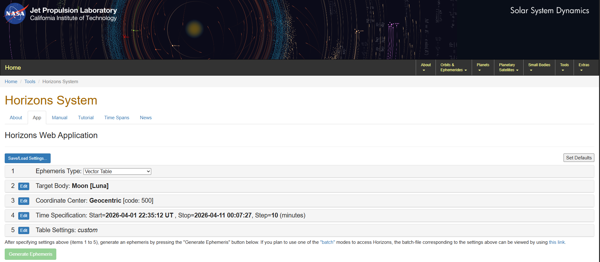
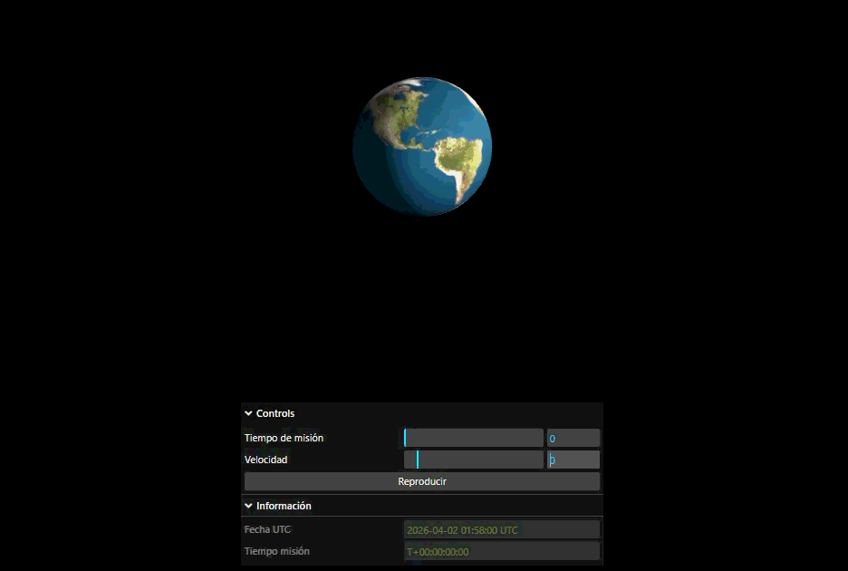
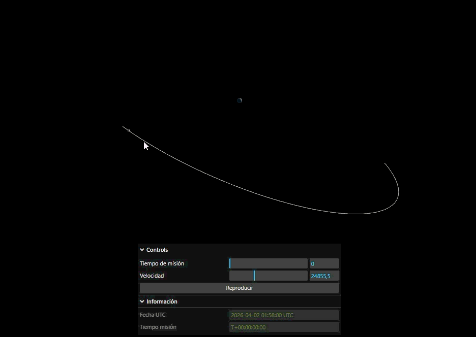
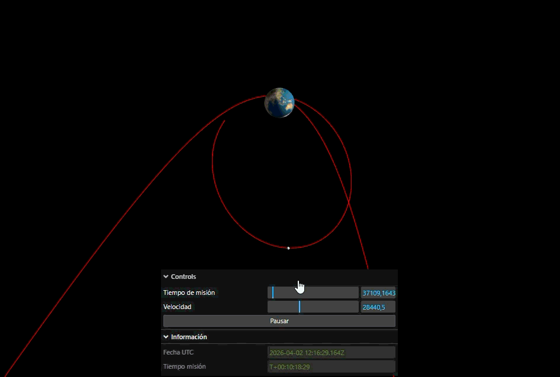
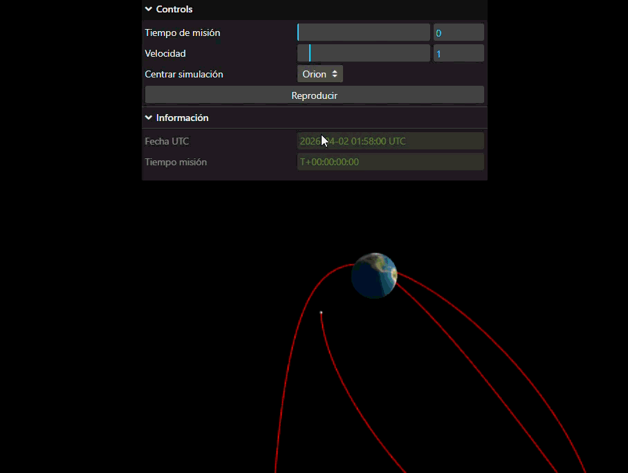

# Visualización del recorrido de la misión Artemis II en Three.js

## Juan Francisco Almeida Santana (ULPGC | EII)

En este repositorio se describen los pasos llevados a cabo y se adjunta un video con el resultado del proyecto realizado para la práctica 8 de la asignatura Informática Gráfica, impartida por la EII en la ULPGC en el curso 2026/27, que consiste en una visualizacion de datos geográicos en Three.js.

En mi caso he decidido realizar una visualización de datos recopilados por la NASA del recorrido que realizó la nave Orión durante la misión Artemis II, la cual comenzó el 1 de abril de 2026 y finalizó el 11 de abril de 2026.

Para llevar a cabo este proyecto es necesario primero obtener los datos de posición en tiempo real durante la misión de la nave Orión, y en segundo lugar, datos de la posición de la Luna respecto a la tierra en tiempo real durante el periodo de tiempo que duró la misión.

Para ello se han utilizado fuentes oficiales de la NASA, más en concreto, del JPL la NASA (Jet Propulsion Laboratory), que serán citados debidamente en este documento.

### Enlace a video de YouTube:

https://youtu.be/o4KLVysi9nk

## Índice

1. [Obtención y procesamiento de los datos](#obtención-y-procesamiento-de-los-datos)
2. [Punto de partida inicial](#punto-inicial-de-partida)
3. [Reloj universal para la simulación](#reloj-universal-para-la-simulación)
4. [Interpolación de los datos](#interpolación-de-los-datos)
5. [Añadiendo a la Luna](#añadiendo-a-la-luna)
6. [Añadiendo a la nave Orión](#añadiendo-a-la-nave-orión)
7. [Cambio de perspectiva](#cambio-de-perspectiva)
8. [Referencias](#referencias)

## Obtención y procesamiento de los datos

### Datos relativos al recorrido de la nave Orión

Los datos relativos a la posición en tiempo real de la nave Orión se han extraido del [PDS de la NASA](https://pds.nasa.gov/)

El PDS de la NASA (por sus siglas en inglés, Planetary Data System, o Sistema de Datos Planetarios) es un archivo digital a largo plazo que almacena y distribuye todos los datos científicos recopilados por las misiones planetarias de la NASA, ofreciendo un acceso gratuito y de libre acceso a los datos

Los datos utilizados se encuentran en el [este enlace](https://naif.jpl.nasa.gov/pub/naif/ARTEMIS/kernels/spk/) que lleva a un directorio donde se encuentra el fichero EM2_FODNAVBET_revF_PUBLIC.oem, este contiene la reconstrucción de la mejor trayectoria estimada de la nave Orión durante la misión Artemis II

Este fichero se ha tratado con un script de Python, [oem_a_json.py](./scripts/oem_a_json.py), que se encuentra en este repositorio en el directorio /scripts, el cual se ejecuta en una terminal de la siguiente forma:

```bash
>  python oem_a_json.py EM2_FODNAVBET_revF_PUBLIC.oem -o Orión.json --step 10
```

Se indica el fichero a procesar (se descargó y se incluyó al proyecto previamente) y devuelve un fichero json con todos los datos, se incluye un aprámetro step para suavizar el tamaño de este fichero js

El fichero resultante, [Orión.json](./src/data/Orión.json) se encuentra dentro del directorio /src/data en el proyecto

### Datos relativos a la posición de la Luna respecto a la tierra

Los datoss relativos a la posición de la Luan con respecto de la tierra se han extraído de [JPL Horizonts](https://ssd.jpl.nasa.gov/horizons/app.html#/), es un servicio en línea que calcula efemérides precisas de objetos del Sistema Solar para observadores, planificadores de misiones, investigadores y público general.

Lo proporciona el grupo de Dinámica del Sistema Solar (SSD) del JPL de la NASA, es de libre uso y gratuito mientras se citen los datos extraídos y la fecha de extracción de los datos.

JPL Horizonts cuenta con una API a la que se le pueden solicitar estos datos pero también cuenta con una aplición web con la que puedes descargar los datos, se han descargado desde ahí con las siguientes configuraciones:




Con estas configuraciones descargaremos un fichero en formato de texto cuyo contenido se encuentra organizado en formato csv, "horizonts_result.txt"

Este fichero contiene información general sobre la Luna, en su cabecera y posteriormente, información con el siguiente formato:

```csv
JDUT, Calendar Date (UT), X, Y, Z,
```

A diferencia del formato de los datos con el que venia la trayectoria de la nave Orión, Horizonts devuelve la posición relativa de la Luna a la tierra en el marco Eclíptico J2000 (el sistema de coordenadas celestes de referencia estándar en astronomía), por lo que será necesario pasar estas coordenadas al sistema de referencia EME2000 (un sistema de referencia ecuatorial cuyo plano XY coincide con el ecuador terrestre medio en la época J2000), que posteriormente escalaremos y adaptaremos al sistema de referencia de three.js

Para ello será necesario aplicar un ángulo de rotación alrededor del eje X de 23.4392911º, por lo que se ha añadido al proyecto un scrpit de Python [horizonts_a_json.py](./scripts/horizons_a_json.py) que se encarga de tomar este fichero y devolver un archivo json con todos los datos de la Luna, usando el mismo formato que Orión.json, el cual se ejecuta con el siguiente comando en una terminal en el directorio del proyecto:

```bash
> python horizons_a_json.py horizons_results.txt -o luna.json
```

Dando como resultado el fichero luna.json.

## Punto inicial de partida

Vamos a partir de una escena sencilla donde tenemos en un espacio a la Tierra que recibe una ligera iluminación "simlando al sol" y con una pequeña luz ambiente para que la escena no sea totalmente oscura, reciclando una de las texturas del proyecto de partida de la práctica 8


## Reloj universal para la simulación

El primer paso que debemos dar para la simulación, es añadir un reloj que orqueste el movimiento de la tierra, de la nave Orión y de la Luna, de forma que todos ellos vayan al mismo compás, este reloj debe marcar la fecha y la hora en cada momento, y además sería ideal poder desplazarse en el tiempo y acelerar o decelerar la velocidad de la simulación.

Para ello se añaden las siguientes variables y se importa el módulo GUI.

```js
const reloj = new THREE.Clock();

const INICIO_MISION = Date.UTC(2026, 3, 2, 1, 58, 0);
const FIN_MISION = Date.UTC(2026, 3, 10, 23, 53, 0);

const DURACION_MISION = (FIN_MISION - INICIO_MISION) / 1000;

const estado = {
  t: 0,
  reproduciendo: false,
  velocidad: 1
};

let gui;
let botonPlay;

const informacion = {
  fechaUTC: "",
  tiempoMision: ""
};
```

Definimos los instantes de inicio y fin de la misión Artemis II y tenemos dos constantes relativas al estado de la misión, las variables estado e información, las cuales como tal son las que definen este reloj, y para poder actualizarlo en función a la velocidad de la simulación o manualmente, se crea una interfaz de usuario y se añade la siguiente función

```js
function actualizarGUI() {

  const fecha = new Date(INICIO_MISION + estado.t * 1000);

  // Fecha UTC
  informacion.fechaUTC = fecha.toISOString()
    .replace("T", " ")
    .replace(".000Z", " UTC");

  // Tiempo transcurrido de misión
  const tiempo = Math.floor(estado.t);

  const dias = Math.floor(tiempo / 86400);
  const horas = Math.floor((tiempo % 86400) / 3600);
  const minutos = Math.floor((tiempo % 3600) / 60);
  const segundos = tiempo % 60;

  informacion.tiempoMision =
    `T+${String(dias).padStart(2, "0")}:` +
    `${String(horas).padStart(2, "0")}:` +
    `${String(minutos).padStart(2, "0")}:` +
    `${String(segundos).padStart(2, "0")}`;

  // Actualizar el nombre del botón
  botonPlay.name(
    estado.reproduciendo ? "Pausar" : "Reproducir"
  );

}
```

A esta función la llamamos en el animatiónLoop, que es donde se actualiza también según este reloj la orientación de la tierra en su eje de rotación (puesto a que rota siguiendo este mismo reloj)

```js
function animationLoop() {

  requestAnimationFrame(animationLoop);

  const delta = reloj.getDelta();

  if (estado.reproduciendo) {

    estado.t += delta * estado.velocidad;

    estado.t = THREE.MathUtils.clamp(
      estado.t,
      0,
      DURACION_MISION
    );

    // Detener al alcanzar los extremos
    if (estado.t === 0 || estado.t === DURACION_MISION) {
      estado.reproduciendo = false;
    }
  }

  // Rotación terrestre según el tiempo absoluto
  tierra.rotation.y =
    (2 * Math.PI / PERIODO_ROTACION) * estado.t;

  actualizarGUI();

  renderer.render(scene, camera);
}
```

El resultado, por ahora, es un reloj manipulable con el que podemos hacer girar la tierra



## Interpolación de los datos 

Dado que no tenemos los datos de ambas trayectorias para cada segundo de simulación, vamos a tener que interpolar las posiciones intermedias entre instantes de tiempo para poder simular con precisión, para ello y dado que las trayectorias de la Luna y la nave Orión están en el mismo formato, vamos a crear una función universal que nos permita interpolar una posición para un instante de tiempo:

```js

function interpolarPosicion(datos, tiempo) {
    const tiempos = datos.t;
    const posiciones = datos.pos;

    // Comprobar que existen muestras.
    if (!tiempos.length || tiempos.length !== posiciones.length) {
        throw new Error("Los datos de trayectoria no son válidos");
    }

    // Si el tiempo está fuera del intervalo, devolver el extremo más cercano.
    if (tiempo <= tiempos[0]) {
        return new THREE.Vector3(...posiciones[0]);
    }

    const ultimo = tiempos.length - 1;

    if (tiempo >= tiempos[ultimo]) {
        return new THREE.Vector3(...posiciones[ultimo]);
    }

    // Búsqueda binaria: encontrar las dos muestras que rodean tiempo.
    let izquierda = 0;
    let derecha = ultimo;

    while (izquierda < derecha - 1) {
        const medio = Math.floor((izquierda + derecha) / 2);

        if (tiempos[medio] <= tiempo) {
            izquierda = medio;
        } else {
            derecha = medio;
        }
    }

    // Calcular cuánto hemos avanzado entre ambas muestras.
    const t0 = tiempos[izquierda];
    const t1 = tiempos[derecha];

    const proporcion = (tiempo - t0) / (t1 - t0);

    // Interpolar linealmente las coordenadas.
    const posicion = new THREE.Vector3();

    posicion.lerpVectors(
        new THREE.Vector3(...posiciones[izquierda]),
        new THREE.Vector3(...posiciones[derecha]),
        proporcion
    );

    return posicion;
}

```

Esta función realiza una búsqueda binaria en el fichero para buscar las dos muestras que se encuentran entre un intervalo de tiempo, calcula la diferencia temporal entre las posiciones e interpola la posición del objeto, y devuelve la posición interpolada en XYZ.

Con esta función ya podemos comenzar a añadir la trayectorias.

## Añadiendo a la Luna

Para implementar la luna, primero se ha importado el fichero luna.json y se han declarado variables para la Luna:

```js
// Parámetros de la Luna
let datosLuna;
let luna;

const PERIODO_ROTACION_LUNA = 27.321661 * 24 * 60 * 60;

async function cargarDatosLuna() {
    const respuesta = await fetch("./data/luna.json");
    datosLuna = await respuesta.json();
}

```

Posteriormente se ha añadido en el script una función "Luna" que crea el objeto en la escena y lo inicializa en la primera posición que marcan el fichero con su registro de posiciones:

```js
function Luna(scene, datos, texturaLuna) {

    const textura = new THREE.TextureLoader().load(texturaLuna);
    textura.colorSpace = THREE.SRGBColorSpace;

    const geometria = new THREE.SphereGeometry(datos.luna_radio, 64, 64);
    const material = new THREE.MeshPhongMaterial({
        map: textura,
        shininess: 5
    });

    luna = new THREE.Mesh(geometria, material);
    scene.add(luna);


    // Crear los puntos de la trayectoria orbital.
    const puntos = datos.pos.map(pos =>
        new THREE.Vector3(...pos)
    );

    // Crear la geometría de la trayectoria.
    const geometriaOrbita = new THREE.BufferGeometry().setFromPoints(puntos);
    const materialOrbita = new THREE.LineBasicMaterial({color: 0xaaaaaa});
    const orbita = new THREE.Line(
        geometriaOrbita,
        materialOrbita
    );

    scene.add(orbita);
    luna.position.copy(interpolarPosicion(datos, 0));
}
```

Esta función además crea la órbita de la Luna (sólamente la trayectoria que sigue la luna, no la órbita completa de la Luna) y por último se modificó la función init para que esperase a la carga de los datos del fichero y llamase a la función Luna.

Además se modificó animationLoop para que actualizase en base al tiempo la posición de la Luna respecto a la tierra y para que la Luna girase sobre su propio eje:

```js
async function init() {

  await cargarDatosLuna();

 ...

  camera.position.set(0, 15, 100);

...

  //Objetos
  Tierra(RADIO_TIERRA, "./assets/earthmap1k.jpg");
  Luna(scene, datosLuna, "./assets/2k_moon.jpg");

  var controls = new OrbitControls(camera, renderer.domElement);
  controls.minDistance = RADIO_TIERRA * 1.2;

  crearGUI();
}

...

function animationLoop() {

...

  // Rotacion de la Tierra y de la Luna
  tierra.rotation.y = (2 * Math.PI / PERIODO_ROTACION) * estado.t;
  luna.rotation.y = (2 * Math.PI / PERIODO_ROTACION_LUNA) * estado.t;

    // actualzia la posición de la Luna interpolando la posición
  luna.position.copy(interpolarPosicion(datosLuna, estado.t));

  actualizarGUI();

  renderer.render(scene, camera);
}
```

De esta forma se implementa la trayectoria que recorrió la Luna los días de la misión Artemis II



## Añadiendo a la nave Orión

Para añadir la trayectoria de la nave Orión replicaremos lo que hicimos para añadir la trayectoria de la Luna, con la única diferencia de que usarmeos los datos del fichero orion.json.

Lo primero es crear una función, como Luna(), que cree un objeto en la escena y dibuje la trayectoria en la escena:

```js
function Orion(scene, datos) {

    const geometria = new THREE.SphereGeometry(0.05, 16, 16);
    const material = new THREE.MeshPhongMaterial({
        color: 0xffffff,
        shininess: 30
    });

    orion = new THREE.Mesh(geometria, material);
    scene.add(orion);

    // Situar inicialmente Orion.
    orion.position.copy(interpolarPosicion(datos, 0));

    // Crear la trayectoria orbital.
    const puntos = datos.pos.map(pos =>
        new THREE.Vector3(...pos)
    );

    const geometriaOrbita = new THREE.BufferGeometry().setFromPoints(puntos);
    const materialOrbita = new THREE.LineBasicMaterial({
        color: 0xff0000
    });
    const orbita = new THREE.Line(
        geometriaOrbita,
        materialOrbita
    );

    scene.add(orbita);
}
```

Y posteriormente añadimos las variables necesarias, llamamos al método Orion() en init() y añadimos la actualziación de la posición del objeto en animationLoop()

```js
// Parametros de la nave Orion
let datosOrion;
let orion;

async function cargarDatosOrion() {
    const respuesta = await fetch("./data/orion.json");
    datosOrion = await respuesta.json();
}

...

async function init() {

  await cargarDatosLuna();
  await cargarDatosOrion();

  ...

  //Objetos
  Tierra(RADIO_TIERRA, "./assets/earthmap1k.jpg");
  Luna(scene, datosLuna, "./assets/2k_moon.jpg");
  Orion(scene, datosOrion);

  var controls = new OrbitControls(camera, renderer.domElement);
  controls.minDistance = RADIO_TIERRA * 1.2;

  crearGUI();
}

...


function animationLoop() {

...

  // interpolación de posiciones de la Luna y de la nave Orion
  luna.position.copy(interpolarPosicion(datosLuna, estado.t));
  orion.position.copy(interpolarPosicion(datosOrion, estado.t));

  actualizarGUI();

  renderer.render(scene, camera);
}
```

Con esto ya habríamos implementado la trayectoria de la nave Orión y tendríamos una simulación de la trayectoria realizada hasta la Luna y la vuelta a la tierra



## Cambio de perspectiva

Por último, se añade la posibilidad que desde los controles de la simulación, se pueda cargar el centro de observación, entre la Tierra, la Luna y la nave Orión, para ello debemos declarar los controles orbitales como una variable, modificar la función crearGUI para añadir un desplegable y crear una función que gestione el cambio de cámara

```js
let controls;

const seguimiento = {
    centro: "Tierra"
};

const objetivoCamara = new THREE.Vector3();

...

function actualizarCentroCamara() {

  let objeto;

  switch (seguimiento.centro) {
      case "Tierra":
          objeto = tierra;
          break;

      case "Luna":
          objeto = luna;
          break;

      case "Orion":
          objeto = orion;
          break;
  }

  objeto.getWorldPosition(objetivoCamara);

  const desplazamiento = objetivoCamara.clone().sub(controls.target);
  camera.position.add(desplazamiento);
  controls.target.copy(objetivoCamara);

  controls.update();
}
```

La función actualizarCentroCamara se encarga de que siempre la simulación se encuentre centrada en el objeto seleccionado por el desplegable. A esta función se le llama al final de animationLoop

```js
function animationLoop() {

...

  actualizarGUI();
  actualizarCentroCamara();

  renderer.render(scene, camera);
}
```

Con esto conseguimos el siguiente resultado



## Referencias

### Datos y assets

- Enlace a los datos de la trayectoria de la nave Orión en la misión Artemis II

    [PDS de la NASA](https://pds.nasa.gov/)

- Enlace a los datos de la trayectoria de la Luna (extracción de los datos el dia 12/11/2026)

    [JPL Horizonts](https://ssd.jpl.nasa.gov/horizons/app.html#/)

- Enlace a textura de la Luna

    [Solar System Scopes (Moon)](https://www.solarsystemscope.com/textures/)

### Conversaciones con IA

- Conversación para búsqueda de datos para el proyecto

    [Claude](https://claude.ai/share/f886a83d-e823-45d6-a18f-4a8eec3638fd)

    [Claude](https://claude.ai/share/5c0450f0-0065-4d19-837b-50ab26f4a9da)

- Conversaciones para asistencia en el tratado de los datos extraidos

    [Claude](https://claude.ai/share/e3983f47-6443-41b2-8e53-a0ed4645bc1e)

    [ChatGPT](https://chatgpt.com/share/6af77f70-32f0-83ed-92e6-12b20a6cd18e)

- Conversación para asistencia en la programación del reloj

    [ChatGPT](https://chatgpt.com/share/6af77fb7-7d80-83eb-9190-96d248d3c767)

- Conversación para asistencia en la programación de la interpolación de los datos

    [ChatGPT](https://chatgpt.com/share/6af77f70-32f0-83ed-92e6-12b20a6cd18e)
