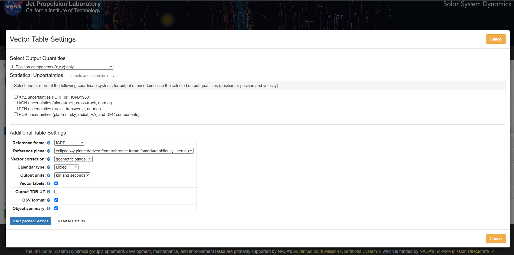
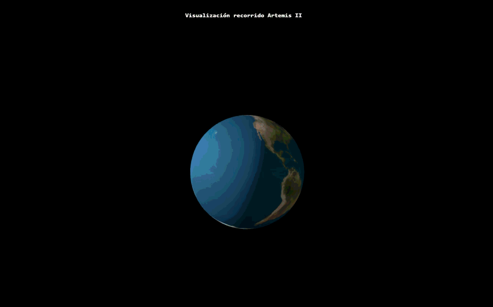

# Visualización del recorrido de la misión Artemis II en Three.js

## Juan Francisco Almeida Santana (ULPGC | EII)

En este repositorio se describen los pasos llevados a cabo y se adjunta un video con el resultado del proyecto realizado para la práctica 8 de la asignatura Informática Gráfica, impartida por la EII en la ULPGC en el curso 2026/27, que consiste en una visualizacion de datos geográicos en Three.js.

En mi caso he decidido realizar una visualización de datos recopilados por la NASA del recorrido que realizó la nave Orión durante la misión Artemis II, la cual comenzó el 1 de abril de 2026 y finalizó el 11 de abril de 2026.

Para llevar a cabo este proyecto es necesario primero obtener los datos de posición en tiempo real durante la misión de la nave Orión, y en segundo lugar, datos de la posición de la Luna respecto a la tierra en tiempo real durante el periodo de tiempo que duró la misión.

Para ello se han utilizado fuentes oficiales de la NASA, más en concreto, del JPL la NASA (Jet Propulsion Laboratory), que serán citados debidamente en este documento.

## Índice

1. [Obtención y procesamiento de los datos](#obtención-y-procesamiento-de-los-datos)
2. [Punto de partida inicial](#punto-inicial-de-partida)
3. [Añadiendo a la Luna]()
4. [Añadiendo a la nave Orión]()

## Obtención y procesamiento de los datos

### Datos relativos al recorrido de la nave Orión

Los datos relativos a la posición en tiempo real de la nave Orión se han extraido del [PDS de la NASA](https://pds.nasa.gov/)

El PDS de la NASA (por sus siglas en inglés, Planetary Data System, o Sistema de Datos Planetarios) es un archivo digital a largo plazo que almacena y distribuye todos los datos científicos recopilados por las misiones planetarias de la NASA, ofreciendo un acceso gratuito y de libre acceso a los datos

Los datos utilizados se encuentran en el [este enlace](https://naif.jpl.nasa.gov/pub/naif/ARTEMIS/kernels/spk/) que lleva a un directorio donde se encuentra el fichero EM2_FODNAVBET_revF_PUBLIC.oem, este contiene la reconstrucción de la mejor trayectoria estimada de la nave Orión durante la misión Artemis II

Este fichero se ha tratado con un script de Python, [oem_a_json.py](./scripts/oem_a_json.py), que se encuentra en este repositorio en el directorio /scripts, el cual se ejecuta en una terminal de la siguiente forma:

```bash
>  python oem_a_json.py EM2_FODNAVBET_revF_PUBLIC.oem -o orion.json --step 10
```

Se indica el fichero a procesar (se descargó y se incluyó al proyecto previamente) y devuelve un fichero json con todos los datos, se incluye un aprámetro step para suavizar el tamaño de este fichero js

El fichero resultante, [orion.json](./src/data/orion.json) se encuentra dentro del directorio /src/data en el proyecto

### Datos relativos a la posición de la Luna respecto a la tierra

Los datoss relativos a la posición de la Luan con respecto de la tierra se han extraído de [JPL Horizonts](https://ssd.jpl.nasa.gov/horizons/app.html#/), es un servicio en línea que calcula efemérides precisas de objetos del Sistema Solar para observadores, planificadores de misiones, investigadores y público general.

Lo proporciona el grupo de Dinámica del Sistema Solar (SSD) del JPL de la NASA, es de libre uso y gratuito mientras se citen los datos extraídos y la fecha de extracción de los datos.

JPL Horizonts cuenta con una API a la que se le pueden solicitar estos datos pero también cuenta con una aplición web con la que puedes descargar los datos, se han descargado desde ahí con las siguientes configuraciones:




Con estas configuraciones descargaremos un fichero en formato de texto cuyo contenido se encuentra organizado en formato csv, "horizonts_result.txt"

Este fichero contiene información general sobre la Luna, en su cabecera y posteriormente, información con el siguiente formato:

```csv
JDUT, Calendar Date (UT), X, Y, Z,
```

Nos interesan los 4 ultimos campos, que representan el instente de tiempo en UT en el que la Luna estaba en una posición (X,Y,Z) concreta respecto de la tierra

## Punto inicial de partida

Vamos a partir de una escena sencilla donde tenemos en un espacio a la Tierra que recibe una ligera iluminación "simlando al sol" y con una pequeña luz ambiente para que la escena no sea totalmente oscura, reciclando una de las texturas del proyecto de partida de la práctica 8



